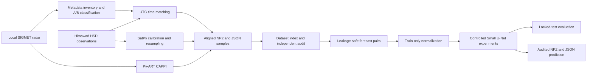

# Nha Be Radar–Himawari Forecasting Pipeline

A research project that turns Nha Be weather radar and Himawari-9 observations into spatially
aligned arrays and evaluates a controlled ten-minute reflectivity forecasting experiment.
The research scope is August 2025; this is an offline portfolio study, not a production service.

## Pipeline



Radar volumes and satellite images have different geometry, sampling, missing values,
and observation times. The pipeline preserves those differences in metadata while aligning
their arrays on one Cartesian grid. Radar classification uses scan metadata rather than
filename suffixes or file sizes.

## Verified research results

| Measure | August 2025 result |
| --- | ---: |
| Input radar volumes | 8,916 |
| Available Himawari cycles | 4,393 |
| Aligned radar–satellite samples | 8,774 |
| Leakage groups | 4,387 |
| Independent full-dataset audit | PASS |

Small historical evidence snapshots are in [docs/validation](docs/validation/README.md).
These results describe the local research dataset, not a production deployment.
Observation files and generated arrays are not distributed in this repository.

## Scientific configuration

The unchanged research configuration is [configs/pipeline.yaml](configs/pipeline.yaml).

- Grid center: 10.6596 N, 106.7283 E; AEQD/WGS84 projection.
- Domain: 400 × 400 km; 256 × 256 pixel centers; 1,562.5 m pixel spacing.
- CAPPI: 1,000 m above the grid origin; `map_gates_to_grid`, `Barnes2`,
  `dist_beam`, minimum radius 500 m.
- Satellite: brightness temperature in K, B08/B13/B14/B15/B16, segments S04/S05,
  bilinear resampling.
- Time matching: radar volume midpoint and local Himawari HSD Block 9 line time;
  nearest available cycle within 180 seconds.
- Missing values: float32 NaN and boolean masks; no zero filling or normalization.

## Repository structure

```text
configs/                  Scientific configuration
src/nhabe_preprocessing/  Reusable processing code
src/nhabe_forecasting/    Dataset, model, evaluation and inference code
scripts/                  Ordered processing stages and CLI wrapper
tests/                    Data-contract unit tests
tests_ai/                 Dedicated PyTorch contract tests
examples/                 Synthetic sample instructions
docs/validation/          Small research evidence snapshots
```

The stack includes Python, NumPy, Py-ART, SatPy, Pyresample, PyYAML, and aiohttp.
This repository starts with a fresh Git history containing only the selected project files.

## Run locally

Use a Python environment with the versions in `requirements.txt` installed. From the
repository root:

```bash
python -m pip install -r requirements.txt
python scripts/nhabe_pipeline.py --help
python scripts/nhabe_pipeline.py doctor
python scripts/nhabe_pipeline.py test
python scripts/nhabe_pipeline.py sample --output output/sample
```

The mock command writes, reopens, and validates synthetic NPZ/JSON arrays. It does not
decode SIGMET/HSD observations or test real-data interpolation. To run a wrapper from
another working directory, pass its absolute path. The package and console entry point
are defined in `pyproject.toml`; editable installation remains to be verified.

## Tests

```bash
python -m unittest discover -s tests -v
```

See [test coverage](docs/testing.md). The expanded suite has 21 test methods for configuration,
A/B metadata, timing boundaries, NaN/masks, serialization, and CLI execution from another
directory. All 21 passed locally and in the rebuilt ARM64 container, as confirmed by the
project owner. The expanded suite's hosted CI also passed both Python and Docker jobs
in [run #3](https://github.com/nhphu206/nhabe-radar-himawari-portfolio/actions/runs/38147133453),
as confirmed by the project owner's screenshot.
Tests use synthetic arrays and temporary files.

## Run with Docker

The image build, five container unit tests, and a persistent synthetic sample run passed on
Linux ARM64 via Docker Desktop. The sample was also reopened and validated on the host.
See [the Docker walkthrough](docs/docker.md) for the image layout, output mounts, and limits.

```bash
docker build --progress=plain -t nhabe-preprocessing:dev .
docker run --rm nhabe-preprocessing:dev test
mkdir -p output/docker-sample
docker run --rm \
  --mount type=bind,source="$(pwd)/output/docker-sample",target=/app/output \
  nhabe-preprocessing:dev sample --output /app/output
```

The multi-stage build compiles dependencies in a builder, then copies the Python environment
into a runtime image without the compiler toolchain. The image runs a non-root batch CLI and
includes code, tests, dependencies, and the scientific configuration. Input observations and
private documents are excluded. The corrected build resolved the first attempt's missing-gcc
failure. Docker Desktop reported 1.22 GB disk usage and 271 MB content size for the tested image.

## Continuous integration

The [GitHub Actions workflow](.github/workflows/ci.yml) checks Python tests, a synthetic sample,
Docker build, container tests, and persisted output validation on pushes and pull requests.
No user-supplied secrets are required. The first hosted run passed both jobs on Linux AMD64.
See [CI details](docs/ci.md) for job order, runner architecture, and scope.

## Compose sample workflow

Compose keeps mount settings in versioned YAML. The configuration is read-only and synthetic
output is writable and persistent. The synthetic run and read-only output revalidation passed
on macOS ARM64 with Docker Desktop:

```bash
mkdir -p output/compose-sample
docker compose config --quiet
docker compose run --rm pipeline sample --output /app/output
```

See [the Compose walkthrough](docs/compose.md). Real inputs are configured separately using
`compose.real-data.yaml`; no observations are mounted for the mock command above.

## Real-data processing stages

Prepare your own authorized input files at the locations in `configs/pipeline.yaml`.
Time matching requires locally available timing HSD files or validated header caches
before the selective image-download step can run. The repository does not yet provide
an automatic header-cache bootstrap from an empty data directory.

| Order | CLI step | Purpose |
| --- | --- | --- |
| 1 | `inventory` | Read radar geometry and representative time |
| 2 | `match-time` | Build the radar–satellite time manifest |
| 3 | `download-himawari YYYYMMDD` | Download selected bands/segments for matched cycles |
| 4 | `preprocess-day YYYYMMDD` | Generate and validate paired samples |
| 5 | `preprocess-month` | Coordinate the full August research run |
| 6 | `build-index` | Build dataset index and summary |
| 7 | `audit` | Reopen samples and validate dataset invariants |
| 8 | `provenance` | Record software versions and configuration checksum |

For example, `python scripts/nhabe_pipeline.py step inventory --date 20250801 --limit 2`
runs a small inventory. Use a separate path configuration for experiments so that a limited
inventory does not overwrite a full-run manifest. Index and audit stages currently assume
the complete August dataset and its configured expected counts.

## Output schema and quality checks

Each real sample has an NPZ containing six arrays and a JSON containing source, grid,
band order, observation times, matching result, and descriptive quality statistics.
See the [data dictionary](docs/data-dictionary.md) for field meanings, axis order,
mask semantics, metadata, CSV statuses, and leakage groups.

| NPZ key | Shape | Type/unit |
| --- | --- | --- |
| `radar_reflectivity_dbz` | 256 × 256 | float32, dBZ |
| `radar_data_valid_mask` | 256 × 256 | bool |
| `radar_range_support_mask` | 256 × 256 | bool |
| `himawari_bt` | 5 × 256 × 256 | float32, K |
| `himawari_band_valid_mask` | 5 × 256 × 256 | bool |
| `himawari_all_bands_valid_mask` | 256 × 256 | bool |

Validation checks shapes, types, finite-value masks, the AND of band masks, and time tolerance.
Files use atomic replacement and are reopened after writing. Day manifests describe processing
outcomes; the dataset index maps sample identifiers to NPZ/JSON paths.

`leakage_group_id` is a dependency key in the dataset index: A/B samples sharing one Himawari
cycle must remain in the same train/validation/test partition. The five satellite bands are
stored in the configured channel order. Grid spacing is not the native sensor resolution.

## Limitations and next engineering steps

- Docker and Compose synthetic-contract checks passed locally on ARM64. CI passed Python
  and Docker checks on Linux AMD64. Real-data preprocessing inside Docker, the real-data
  Compose overlay remain to be verified. Expanded entrypoint/error tests passed locally
  and in the ARM64 container; the expanded suite's hosted CI also passed both jobs.
- Dependency versions are pinned at the application level; a complete platform lock is pending.
- The audit validates the data contract, not meteorological accuracy or optimal CAPPI parameters.
- No comprehensive radar quality-control chain, multi-month replication, uncertainty estimate
  or production deployment has been completed. This is reflectivity forecasting, not lightning
  or rainfall prediction.
- Raw-data redistribution is not included. A complete bundled-component license and
  corresponding-source review is required before distributing built container images.

Future model work requires agreed labels and lead times, temporal/group-aware splits, and
normalization calculated only from training data.

## Forecasting extension (in progress)

The task is **next-volume reflectivity forecasting with exact 10-minute radar midpoint
separation**, not rainfall or lightning prediction. The A-only index contains 842 exact
same-day candidate pairs. No timestamps are rounded and no nearest-time targets are substituted.

The observation-timing protocol uses radar observation end as the research input cutoff
and takes satellite arrays from the previous nominal cycle's NPZ, not the current radar
NPZ. All five bands × two segments must have header observation-end and file-creation
times no later than cutoff. Missing previous cycles are excluded without fallback.
The real-data header audit retained **822 pairs**: train **508** (August 1–21), validation
**141** (22–26), test **173** (27–31). All **8,220 source headers** were checked.
Fifteen candidates lacked the previous cycle in the A index; five crossed a date boundary.

These are observation/creation-time checks, **not verified operational availability**.
Target midpoints are 514.5–527 seconds after cutoff; this is not a claim of a 10-minute
forecast from operational issue time. Download and processing latency are unmeasured.
The old 842-pair diagnostic manifest is preserved and is not the training manifest.

```bash
python scripts/09_build_forecast_pairs.py \
  --data-root /path/to/research-workspace \
  --output output/forecasting/observation_timing
```

Use an empty output directory. The command reads source headers/JSON and NPZ paths;
it does not regenerate or overwrite preprocessing arrays. `--limit 2` provides a small
preview in a separate output directory. See [manifest schema](docs/forecasting_manifest.md),
[Vietnamese learning notes](docs/forecasting_learning_notes.md), and
[pair configuration](configs/forecasting.yaml). The working extension has **67 locally
passing preprocessing/timing tests plus 29 dedicated PyTorch dataset/metric/model/training,
evaluation and inference tests**; Docker/hosted CI have not yet been rerun for these changes.
Official training and one-time locked-test evaluation have completed locally. This extension is not part
of release `v0.1-data-pipeline`.

Train-only normalization is fitted from 508 unique radar input sources and 508 unique
satellite input sources, using finite masked pixels, per-band satellite masks, float64
accumulation and population standard deviation. No validation/test arrays or target-only
sources are added. Physical NPZ arrays are unchanged. See [normalization protocol and
verified statistics](docs/normalization.md).

```bash
python scripts/10_compute_train_statistics.py \
  --data-root /path/to/research-workspace \
  --output output/forecasting/normalization
```

The read-only `ForecastDataset` uses separate manifest paths for input radar, previous-cycle
Himawari and future radar target. It returns finite float32 tensors while preserving boolean
target masks. Radar-only inputs have shape `(B, 2, 256, 256)`; multimodal inputs have shape
`(B, 8, 256, 256)`. Missing physical values are zero-padded only in memory after scaling;
source NPZ files retain NaN and masks. See the [dataset contract](docs/forecasting_dataset.md).

The first development baseline is persistence: future reflectivity is predicted as the
current radar field. On all 141 validation pairs, evaluated over 1,139,645 pixels where
both current and target radar are valid, it obtains **MAE 5.539 dBZ** and **RMSE 8.037 dBZ**.
Metrics are global valid-pixel-weighted values; no reflectivity threshold is applied. The
test split was still locked at this baseline-development stage. See the
[baseline protocol and limitations](docs/persistence_baseline.md).

The controlled model candidate is a three-level Small U-Net 2D with 16 base channels,
GroupNorm and an unrestricted one-channel regression output. The radar-only version has
482,593 trainable parameters; the multimodal version has 483,457. Real 256×256 CPU
forward/backward checks pass for both modes, and a multimodal Apple MPS check also passes.
The architecture contract and early numerical smoke checks are documented in
[the model contract](docs/model.md); official results are summarized below.

Official development training is now complete for both controlled input modes. Both runs use
508 train pairs and select checkpoints on the same 141 validation pairs; all 173 test pairs
remained unopened throughout training. Against persistence (MAE 5.539, RMSE 8.037 dBZ), radar-only reaches MAE
4.495 and RMSE 6.212 dBZ; radar + Himawari reaches MAE 4.421 and RMSE 6.040 dBZ. The
multimodal validation improvement over radar-only is 1.64% MAE and 2.77% RMSE. These are
single-month validation results, not locked-test or operational claims. See the
[training results](docs/training_results.md) and [run journal](docs/training_journal.md).

The one-time locked-test evaluation was executed from clean source commit `b5b8399` on all
173 test pairs. Persistence obtains MAE/RMSE 5.011/7.408 dBZ; radar-only obtains
4.235/5.956 dBZ; multimodal obtains **4.215/5.904 dBZ**. Multimodal reduces test RMSE by
20.30% relative to persistence and 0.88% relative to radar-only. No model or hyperparameter
was changed after opening test data. See the [locked-test audit](docs/final_evaluation.md).

The frozen multimodal checkpoint can now generate one audited prediction without opening the
future target array. The CLI writes float32 dBZ plus an explicit boolean validity mask and
reopens the NPZ/JSON product before returning PASS. See the
[single-sample inference contract](docs/inference.md). This is offline research inference,
not a live API or operational forecast service.

## License

Project-authored code and accompanying documentation are licensed under
**GPL-3.0-or-later**; see [LICENSE](LICENSE) and [third-party notices](NOTICE.md).
Dependencies retain their own licenses. This grant does not cover observation data,
generated research datasets, or personal reports. Docker images are built for local/CI
checks; no image has been published to a registry.
