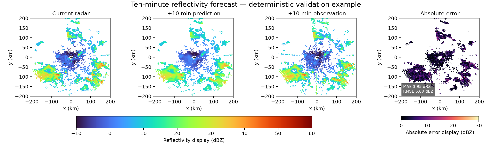
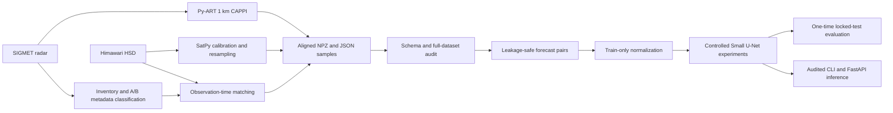
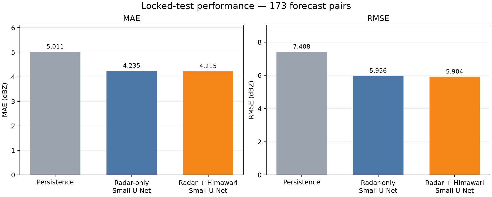
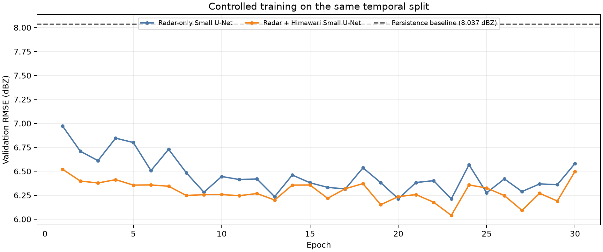

# Nha Be Radar–Himawari Forecasting Pipeline

[](https://github.com/nhphu206/nhabe-radar-himawari-portfolio/actions/workflows/ci.yml)
[](https://github.com/nhphu206/nhabe-radar-himawari-portfolio/releases/latest)
[](pyproject.toml)
[](LICENSE)

An end-to-end research portfolio that transforms Nha Be weather-radar and Himawari-9
observations into spatially aligned arrays, then evaluates controlled deep-learning models
for next-volume radar-reflectivity forecasting.

**Scope:** one station, August 2025, offline research. This is not a production weather service
and does not claim operational forecast skill.



The image is one deterministic validation example. Display ranges are not processing
thresholds. Its source products and the published figures are hash-recorded in
[asset provenance](assets/portfolio/provenance.json).

## At a glance

| Verified outcome | Result |
| --- | ---: |
| Radar volumes inventoried | **8,916** |
| Available Himawari cycles | **4,393** |
| Spatially and temporally aligned samples | **8,774** |
| Leakage groups | **4,387** |
| Causally screened forecast pairs | **822** |
| Locked-test pairs | **173** |
| Multimodal locked-test MAE / RMSE | **4.215 / 5.904 dBZ** |
| RMSE reduction relative to persistence | **20.30%** |
| Independent full-dataset audit | **PASS** |

## Why this project

Radar and satellite observations differ in geometry, sampling, missing-data patterns and
observation time. A forecasting model is only credible if those differences are handled
before training. This project therefore treats data engineering, scientific configuration,
temporal causality and auditability as first-class parts of the ML system.

Key engineering decisions include:

- identifying radar scan strategies from decoded metadata rather than filenames;
- mapping radar CAPPI and five Himawari bands to one versioned 256 × 256 grid;
- preserving missing values as float32 NaN with explicit boolean masks;
- matching local observation times with a 180-second tolerance;
- grouping dependent A/B samples before partitioning;
- fitting normalization from training inputs only;
- keeping the test split locked until model development was complete;
- writing, reopening and validating NPZ/JSON products with provenance hashes.

## Pipeline architecture



## Controlled forecasting experiment

The target is radar reflectivity from the next Signature-A volume, with an exact 600-second
radar-midpoint separation. Satellite input comes from the previous nominal Himawari cycle and
must pass observation-end and file-creation checks against the radar observation-end cutoff.
The audit checked **8,220 HSD headers** and retained **822 pairs**:

| Temporal split | Dates in August 2025 | Pairs |
| --- | --- | ---: |
| Train | 1–21 | 508 |
| Validation | 22–26 | 141 |
| Locked test | 27–31 | 173 |

All methods use the same temporal split, validity-mask evaluation and model family where
applicable. The locked test was opened once after model selection.

| Method | MAE (dBZ) ↓ | RMSE (dBZ) ↓ |
| --- | ---: | ---: |
| Persistence | 5.011 | 7.408 |
| Radar-only Small U-Net | 4.235 | 5.956 |
| Radar + Himawari Small U-Net | **4.215** | **5.904** |



The multimodal model reduces RMSE by **20.30%** relative to persistence and **0.88%**
relative to the controlled radar-only model. The small multimodal gain is reported as observed,
not generalized beyond this one-seed, one-station and one-month experiment.

<details>
<summary><strong>Training curve</strong></summary>



Both Small U-Net variants use the same split, optimization policy and 30-epoch budget.
Checkpoint selection uses validation RMSE only; the dashed line is the persistence-validation
baseline. See [training results](docs/training_results.md) and the
[run journal](docs/training_journal.md).

</details>

## Scientific configuration

The research configuration is versioned in [configs/pipeline.yaml](configs/pipeline.yaml).

| Component | Frozen configuration |
| --- | --- |
| Common grid | 10.6596° N, 106.7283° E; AEQD/WGS84; 400 × 400 km; 256 × 256 |
| Radar | 1,000 m CAPPI; `map_gates_to_grid`; Barnes2; `dist_beam`; 500 m minimum radius |
| Himawari | B08, B13, B14, B15, B16; segments S04/S05; brightness temperature; bilinear resampling |
| Time match | Radar-volume midpoint to local HSD Block-9 observation time; nearest within 180 s |
| Missing data | float32 NaN plus boolean masks; never replaced by physical zero |

## Data contract

Each aligned sample consists of one NPZ and one JSON metadata record. Observation arrays and
generated research datasets are intentionally excluded from Git.

| NPZ key | Shape | Type / meaning |
| --- | --- | --- |
| `radar_reflectivity_dbz` | 256 × 256 | float32 dBZ |
| `radar_data_valid_mask` | 256 × 256 | bool, finite radar values |
| `radar_range_support_mask` | 256 × 256 | bool, geometric support |
| `himawari_bt` | 5 × 256 × 256 | float32 brightness temperature, K |
| `himawari_band_valid_mask` | 5 × 256 × 256 | bool, per-band validity |
| `himawari_all_bands_valid_mask` | 256 × 256 | bool, intersection of all five bands |

`leakage_group_id` keeps radar A/B samples that share one Himawari cycle in the same data
partition. See the complete [data dictionary](docs/data-dictionary.md).

## Quick start with synthetic data

The runnable demonstration uses synthetic arrays and does not redistribute meteorological
observations.

```bash
git clone https://github.com/nhphu206/nhabe-radar-himawari-portfolio.git
cd nhabe-radar-himawari-portfolio
python -m pip install -r requirements.txt
python scripts/nhabe_pipeline.py doctor
python scripts/nhabe_pipeline.py test
python scripts/nhabe_pipeline.py sample --output output/sample
```

The sample command writes an NPZ/JSON pair, reopens it and validates shape, dtype, schema and
NaN-mask consistency. The package also exposes the `nhabe-pipeline` console entry point.

### Docker

```bash
docker build --progress=plain -t nhabe-preprocessing:dev .
docker run --rm nhabe-preprocessing:dev test
mkdir -p output/docker-sample
docker run --rm \
  --mount type=bind,source="$(pwd)/output/docker-sample",target=/app/output \
  nhabe-preprocessing:dev sample --output /app/output
```

Docker uses a non-root runtime user and keeps observations, outputs and checkpoints outside the
image. See [Docker](docs/docker.md) and [Compose](docs/compose.md) for verified workflows.

## Real-data stages

Authorized observation files must be supplied locally. They are never downloaded during tests.

| Order | CLI step | Purpose |
| ---: | --- | --- |
| 1 | `inventory` | Decode radar metadata and classify scan geometry |
| 2 | `match-time` | Build the radar–satellite time manifest |
| 3 | `download-himawari YYYYMMDD` | Fetch only matched bands and segments |
| 4 | `preprocess-day YYYYMMDD` | Generate and validate aligned samples |
| 5 | `preprocess-month` | Coordinate the August research run |
| 6 | `build-index` | Build the dataset index and leakage groups |
| 7 | `audit` | Reopen products and validate invariants |
| 8 | `provenance` | Record software and configuration fingerprints |

Only B08 and B13–B16 segments S04/S05 are downloaded because the common domain intersects those
full-disk segments. This avoids transferring unused full-disk data while preserving every
configured pixel required for the Nha Be grid.

## Inference and API

The frozen multimodal checkpoint supports target-free single-sample inference. The CLI writes
float32 dBZ and an explicit boolean mask, then reopens the NPZ/JSON product before returning
PASS. A minimal FastAPI wrapper exposes health, immutable model identity and prediction by an
audited `pair_id`; it does not accept arbitrary uploaded paths or arrays.

The same service includes an interactive dashboard at `/demo`. It lets a reviewer select an
audited validation pair, run the frozen model and compare current radar with the ten-minute
prediction. The default view never reads the future target. An explicitly enabled historical
evaluation view loads the later observation and absolute error through separate endpoints, so
the interface preserves the causal boundary instead of quietly leaking the answer into
inference.

### One-command visual demo

No observation data or trained checkpoint is required for this software-contract demo:

```bash
docker compose -f compose.demo.yaml up --build
```

Then open <http://127.0.0.1:8000/demo>. The container generates deterministic synthetic radar,
Himawari and historical-target arrays plus an **untrained random-weight checkpoint** in temporary
memory. The dashboard labels that state explicitly. It demonstrates API, validation, masking and
visualization behavior; it does not demonstrate forecast skill. Stop it with `Ctrl+C`, followed by
`docker compose -f compose.demo.yaml down`.

The API and CPU-only AI container are portfolio demonstrations without authentication,
real-time ingestion or operational deployment. See [inference](docs/inference.md) and
[API contract](docs/api.md).

## Testing and CI

- **67** preprocessing, timing and data-contract tests;
- **31** PyTorch dataset, metric, model, training, evaluation, API and demo tests;
- synthetic NPZ/JSON round-trip checks;
- preprocessing and CPU-only AI Docker builds;
- container dashboard/API smoke test, PNG validation and image-content scan;
- GitHub-hosted Linux AMD64 CI on pushes and pull requests.

The latest public main-branch workflow is available under
[GitHub Actions](https://github.com/nhphu206/nhabe-radar-himawari-portfolio/actions).
Tests require no raw observations, checkpoint or repository secret. Details are in
[docs/testing.md](docs/testing.md) and [docs/ci.md](docs/ci.md).

## Repository map

```text
configs/                  Frozen preprocessing and forecasting configuration
src/nhabe_preprocessing/  Radar–satellite preprocessing and validation
src/nhabe_forecasting/    Dataset, model, evaluation and inference
scripts/                  Ordered pipeline and experiment entry points
tests/                    Preprocessing and timing contract tests
tests_ai/                 PyTorch and API tests
assets/portfolio/         Published figures with hash provenance
docs/                     Methods, contracts, results and limitations
examples/                 Synthetic-demo guidance
```

## Reproducibility and limitations

- Raw radar/Himawari files, the 8.69 GiB generated dataset, trained weights and personal reports
  are not distributed.
- Real-data preprocessing is verified locally but not inside the public Docker demonstration.
- The audit validates data and software contracts, not meteorological truth or optimal CAPPI
  parameters.
- No comprehensive radar quality-control chain, uncertainty analysis, multi-seed replication or
  multi-month generalization study has been completed.
- Radar target midpoints occur 514.5–527 seconds after the research cutoff. Download and
  processing latency are unmeasured, so this is not an operational ten-minute lead-time claim.
- The task is reflectivity forecasting, not rainfall or lightning prediction.

For the exact evaluation protocol, read the [locked-test audit](docs/final_evaluation.md),
[forecast manifest](docs/forecasting_manifest.md) and
[qualitative-result notes](docs/qualitative_results.md).

## Author and license

Built by [Nguyễn Hoài Phú](https://github.com/nhphu206) as a Data Science portfolio project.

Project-authored code and documentation are licensed under **GPL-3.0-or-later**; see
[LICENSE](LICENSE) and [third-party notices](NOTICE.md). This grant does not cover observation
data, generated research datasets, trained checkpoints or personal reports.
